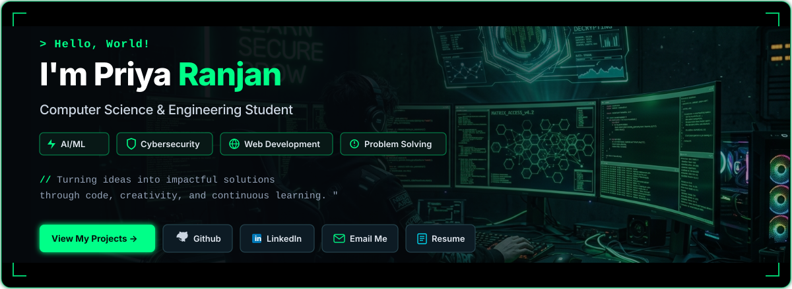
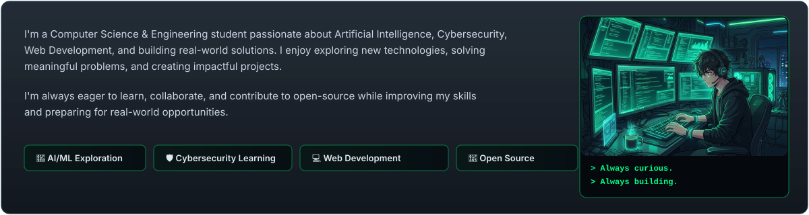
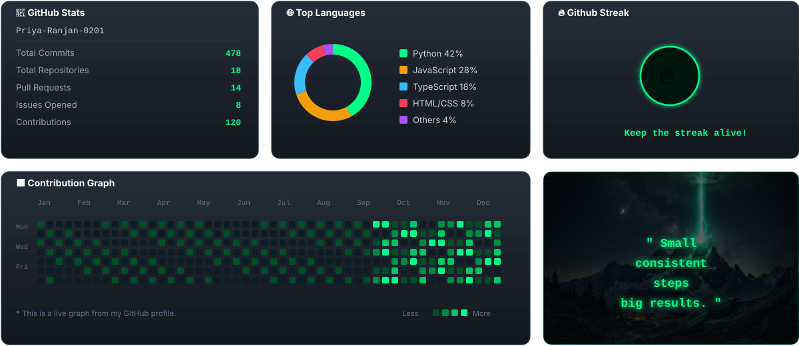
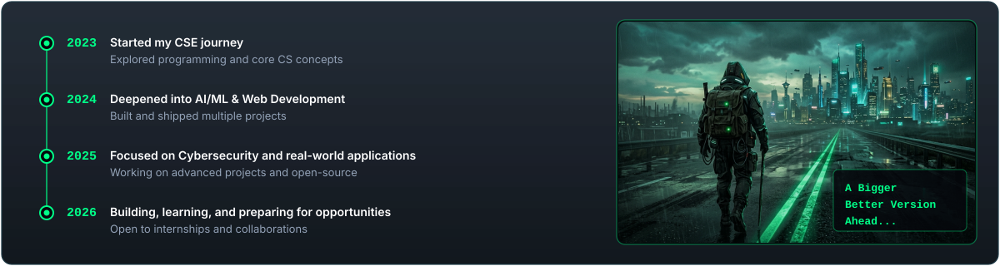
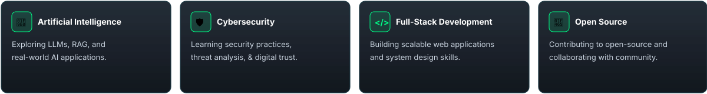
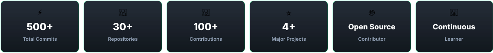

<!-- ======================================================== -->
<!-- 01. HERO BANNER                                          -->
<!-- ======================================================== -->

  

<!-- ACTION BUTTONS ROW -->

  
  &nbsp;
  
  &nbsp;
  
  &nbsp;
  
  &nbsp;
  

 

<!-- ======================================================== -->
<!-- 02. ABOUT ME                                             -->
<!-- ======================================================== -->
## > About Me

  

 

<!-- ======================================================== -->
<!-- 03. FEATURED PROJECTS                                    -->
<!-- ======================================================== -->

  <h2>> Featured Projects</h2>

  

 

<b>🔍 Click to view interactive project repository links &amp; live demos</b>

 

| Project | Tech Stack | Highlights | Links |
| :--- | :--- | :--- | :--- |
| **PrepPilot** | `Python` `NLP` `AI` `LLM` | AI-powered interview preparation assistant combining personalized learning & technical question generation. | [📂 Code](https://github.com/Priya-Ranjan-0201) • [🌐 Live Demo](https://github.com/Priya-Ranjan-0201) |
| **TruthShield X** | `AI/ML` `Security` `Web` | Digital trust & misinformation defense platform focused on fake news detection & digital identity threats. | [📂 Code](https://github.com/Priya-Ranjan-0201/TrustShield-X) • [🌐 Live Demo](https://github.com/Priya-Ranjan-0201/TrustShield-X) |
| **VIREONIQ / PLACE30** | `React` `TypeScript` `AI` `Web` | Career intelligence platform offering resume analysis, placement gap insights & personalized recommendations. | [📂 Code](https://github.com/Priya-Ranjan-0201/VIREONIQ) • [🌐 Live Demo](https://github.com/Priya-Ranjan-0201/VIREONIQ) |
| **Tech On Tour** | `Web` `Travel` `Maps` `AI` | Smart tourism platform for discovering destinations, planning itineraries & exploring local experiences. | [📂 Code](https://github.com/Priya-Ranjan-0201/TECH-ON-TOUR) • [🌐 Live Demo](https://github.com/Priya-Ranjan-0201/TECH-ON-TOUR) |

 

<!-- ======================================================== -->
<!-- 04. TECH STACK                                           -->
<!-- ======================================================== -->
## > Tech Stack

  

 

<!-- ======================================================== -->
<!-- 05. GITHUB ANALYTICS                                     -->
<!-- ======================================================== -->
## > GitHub Analytics

  

 

<!-- ======================================================== -->
<!-- 06. MY JOURNEY                                           -->
<!-- ======================================================== -->
## > My Journey

  

 

<!-- ======================================================== -->
<!-- 07. CURRENTLY EXPLORING                                  -->
<!-- ======================================================== -->
## > Currently Exploring

  

 

<!-- ======================================================== -->
<!-- 08. ACHIEVEMENTS & HIGHLIGHTS                            -->
<!-- ======================================================== -->
## > Achievements &amp; Highlights

  

 

<!-- ======================================================== -->
<!-- 09. LET'S CONNECT                                        -->
<!-- ======================================================== -->
## > Let's Connect

  

  

  ⚡ Designed &amp; Maintained by <b>Priya Ranjan</b> • <i>"Consistent learning today builds better opportunities tomorrow."</i> ⚡

