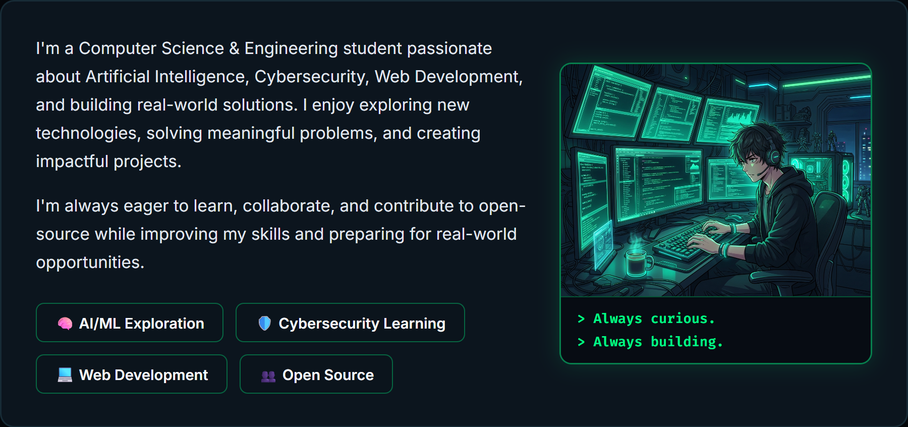
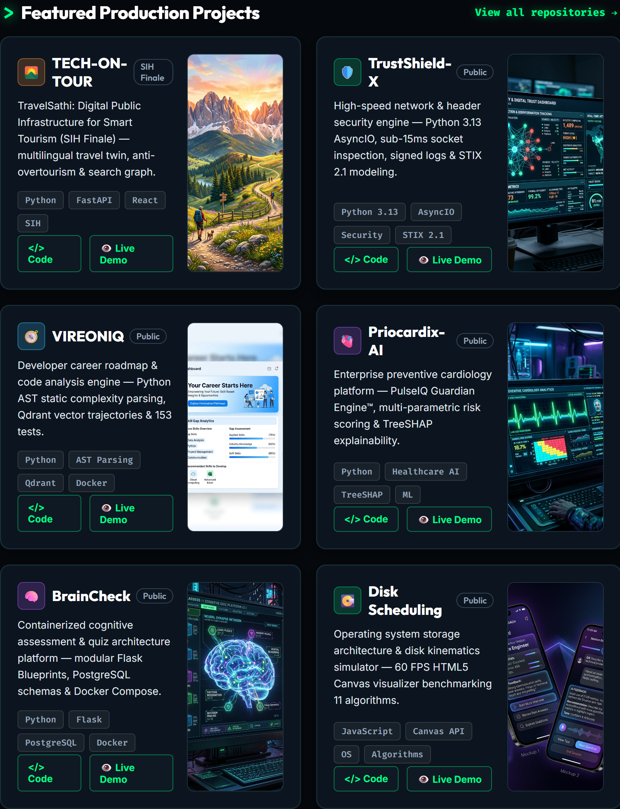
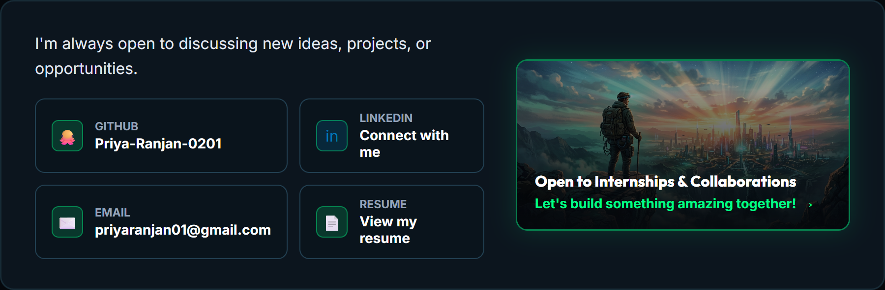

<!-- ======================================================== -->
<!-- 01. HERO BANNER                                          -->
<!-- ======================================================== -->

 

<!-- ======================================================== -->
<!-- 02. ABOUT ME                                             -->
<!-- ======================================================== -->
## > About Me

  

 

<!-- ======================================================== -->
<!-- 03. FEATURED PROJECTS                                    -->
<!-- ======================================================== -->
## > Featured Projects

  

 

<b>🔗 Click for Direct Repository &amp; Live Demo Links</b>

 

| Project | Tech Stack | Quick Links |
| :--- | :--- | :--- |
| **PrepPilot** | `Python` • `NLP` • `AI` • `LLM` | [📂 GitHub Code](https://github.com/Priya-Ranjan-0201) • [🌐 Live Demo](https://github.com/Priya-Ranjan-0201) |
| **TruthShield X** | `AI/ML` • `Security` • `Web` | [📂 GitHub Code](https://github.com/Priya-Ranjan-0201/TrustShield-X) • [🌐 Live Demo](https://github.com/Priya-Ranjan-0201/TrustShield-X) |
| **VIREONIQ / PLACE30** | `React` • `TypeScript` • `AI` • `Web` | [📂 GitHub Code](https://github.com/Priya-Ranjan-0201/VIREONIQ) • [🌐 Live Demo](https://github.com/Priya-Ranjan-0201/VIREONIQ) |
| **Tech On Tour** | `Web` • `Travel` • `Maps` • `AI` | [📂 GitHub Code](https://github.com/Priya-Ranjan-0201/TECH-ON-TOUR) • [🌐 Live Demo](https://github.com/Priya-Ranjan-0201/TECH-ON-TOUR) |

 

<!-- ======================================================== -->
<!-- 04. TECH STACK                                           -->
<!-- ======================================================== -->
## > Tech Stack

  

 

<!-- ======================================================== -->
<!-- 05. GITHUB ANALYTICS                                     -->
<!-- ======================================================== -->
## > GitHub Analytics

  

 

<!-- ======================================================== -->
<!-- 06. MY JOURNEY                                           -->
<!-- ======================================================== -->
## > My Journey

  

 

<!-- ======================================================== -->
<!-- 07. CURRENTLY EXPLORING                                  -->
<!-- ======================================================== -->
## > Currently Exploring

  

 

<!-- ======================================================== -->
<!-- 08. ACHIEVEMENTS & HIGHLIGHTS                            -->
<!-- ======================================================== -->
## > Achievements &amp; Highlights

  

 

<!-- ======================================================== -->
<!-- 09. LET'S CONNECT                                        -->
<!-- ======================================================== -->
## > Let's Connect

  

 

  

    <a href="https://github.com/Priya-Ranjan-0201"><b>🐙 GitHub</b></a>
    &nbsp;&nbsp;•&nbsp;&nbsp;
    <a href="https://www.linkedin.com/in/priyaranjan01"><b>💼 LinkedIn</b></a>
    &nbsp;&nbsp;•&nbsp;&nbsp;
    <a href="mailto:priyaranjan01@gmail.com"><b>✉️ Email</b></a>
    &nbsp;&nbsp;•&nbsp;&nbsp;
    <a href="portfolio/public/Priya_Ranjan_Resume.pdf"><b>📄 Resume</b></a>
  

   
  ⚡ Designed &amp; Maintained by <b>Priya Ranjan</b> • <i>"Consistent learning today builds better opportunities tomorrow."</i> ⚡

