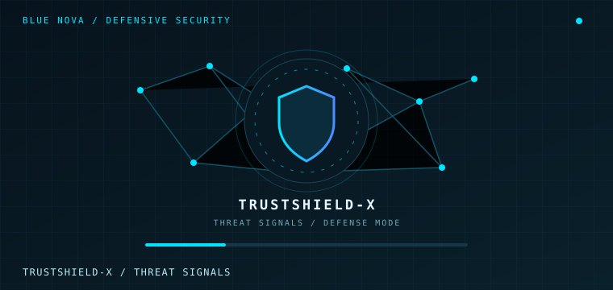
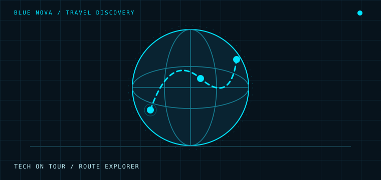
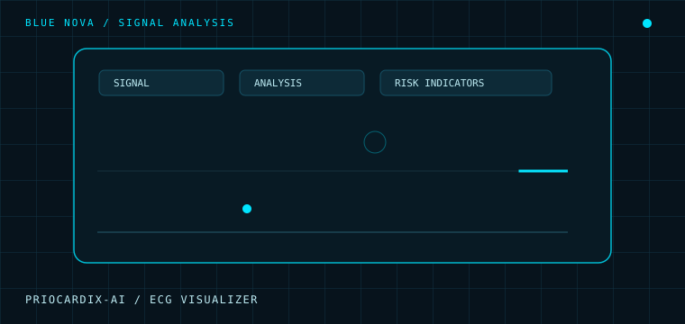
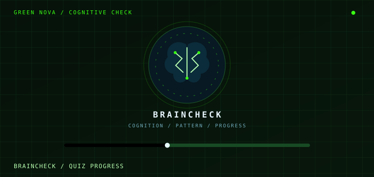
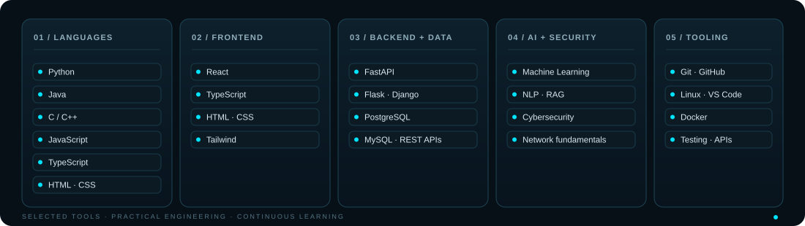

<code>╭─ BLUE NOVA / DEVELOPER PROFILE ─╮</code> BUILDING SMALL · THINKING SYSTEMS · LEARNING EVERY DAY

◉ CURRENT FOCUS: AI/ML &nbsp; · &nbsp; CYBERSECURITY &nbsp; · &nbsp; SOFTWARE ENGINEERING

**COMPUTER SCIENCE & ENGINEERING** · AI/ML · CYBERSECURITY · SOFTWARE ENGINEERING Curious by design. Building with intent.

---

**PRIYA RANJAN** · [@Priya-Ranjan-0201](https://github.com/Priya-Ranjan-0201) · 🎓 Computer Science & Engineering · Lovely Professional University · India

## <code>01 / ABOUT ME</code>

I'm a Computer Science & Engineering student interested in building practical software at the intersection of **AI/ML, cybersecurity, and web engineering**. I enjoy taking an idea from a rough concept to a working system, understanding how its parts fit together, and improving it through iteration.

My focus is on strengthening software engineering fundamentals while building projects that demonstrate applied learning—not just collecting technologies.

**WHAT I CARE ABOUT**

- **Applied AI** — Useful AI-enabled tools, retrieval, language models, and data-driven workflows.
- **Digital Security** — Secure engineering, threat analysis, and defensive tools.
- **Product Engineering** — Connecting frontend experiences, APIs, data, and backend services.
- **Engineering Discipline** — Readable code, clear architecture, testing, and continuous improvement.

**WORKING PRINCIPLES** · Learn the fundamentals · Build useful things · Keep code understandable · Iterate with feedback

## <code>02 / SELECTED WORK</code>

<table>
<tr>
<td width="50%" valign="top">

### [VIREONIQ / PLACEIQ ↗](https://github.com/Priya-Ranjan-0201/VIREONIQ)

Career intelligence and developer-focused tooling combining web application development, code analysis, and personalized guidance.

**React · TypeScript · Python · FastAPI**

</td>
<td width="50%" valign="top">

### [TrustShield-X ↗](https://github.com/Priya-Ranjan-0201/TrustShield-X)

Cybersecurity-focused project exploring network and protocol inspection, defensive engineering, and security-oriented logging.

**Python · AsyncIO · Networking · Security**

</td>
</tr>
<tr>
<td width="50%" valign="top">

### [Tech On Tour ↗](https://github.com/Priya-Ranjan-0201/TECH-ON-TOUR)

Smart tourism concept focused on helping travelers discover places and plan more informed journeys.

**React · Python · APIs · Travel Technology**

</td>
<td width="50%" valign="top">

### [Priocardix-AI ↗](https://github.com/Priya-Ranjan-0201/Priocardix-AI)

AI and data-science project exploring preventive cardiology concepts and explainable, data-informed risk analysis.

**Python · Machine Learning · Data Science**

</td>
</tr>
<tr>
<td width="50%" valign="top">

### [BrainCheck ↗](https://github.com/Priya-Ranjan-0201/BrainCheck)

Cognitive assessment and quiz application project, emphasizing web services and structured application design.

**Python · Flask · PostgreSQL · Docker**

</td>
<td width="50%" valign="top">

OPERATING SYSTEMS · ALGORITHM VISUALIZATION

### [Disk Scheduling Visualizer ↗](https://github.com/Priya-Ranjan-0201/Disk_Scheduling_Algorithm)

Interactive visual exploration of operating-system disk scheduling algorithms and their trade-offs.

**JavaScript · HTML · Canvas · Operating Systems**

</td>
</tr>
</table>

<a href="https://github.com/Priya-Ranjan-0201/HRCV-"><b>HRCV- — AI career / CV tooling ↗</b></a> &nbsp; · &nbsp;
<a href="https://github.com/Priya-Ranjan-0201?tab=repositories"><b>Explore all repositories ↗</b></a>

---

## <code>03 / TECHNOLOGY STACK</code>

CORE LANGUAGES · PRODUCT ENGINEERING · AI/ML · CYBERSECURITY · DEVELOPER TOOLING

---

## <code>04 / GITHUB ANALYTICS</code>

  

  

Stats are fetched by external GitHub-data services and may be cached briefly. Language percentages reflect repository code, while contribution counts follow GitHub's contribution rules.

---

## <code>05 / THE JOURNEY</code>

<table>
<tr>
<td width="65%" valign="top">

**01 — FOUNDATIONS**  
Building core programming knowledge and exploring computer science fundamentals.

**02 — VISUAL SYSTEMS**  
Exploring interactive algorithm visualizations to make system behavior easier to understand.

**03 — FULL-STACK & AI PROJECTS**  
Working across web applications, APIs, data-driven tools, and AI-oriented projects.

**04 — SECURITY & SYSTEM DESIGN**  
Continuing to learn defensive engineering, architecture, testing, and practical software development.

</td>
<td width="35%" valign="middle" align="center">

<code>FOUNDATIONS</code> ↓ <code>VISUAL SYSTEMS</code> ↓ <code>FULL-STACK + AI</code> ↓ <code>SECURE ENGINEERING</code>
  <b>Progress over perfection.</b>

</td>
</tr>
</table>

---

## <code>06 / CURRENTLY EXPLORING</code>

<table>
<tr>
<td width="33%" align="center" valign="top"><b>◈ AI / ML</b> Learning to turn models, data, and retrieval techniques into useful applications.</td>
<td width="33%" align="center" valign="top"><b>◈ Cybersecurity</b> Strengthening foundations in networks, threat analysis, and secure development.</td>
<td width="33%" align="center" valign="top"><b>◈ Software Engineering</b> Improving architecture, APIs, testing, version control, and deployment workflows.</td>
</tr>
</table>

---

## <code>07 / PRINCIPLES & HIGHLIGHTS</code>

| BUILD | LEARN | IMPROVE |
|:---:|:---:|:---:|
| Ship practical projects | Strengthen fundamentals | Iterate from feedback |

I value demonstrable work, honest progress, and clear engineering decisions. Project status and repository activity are linked directly to GitHub rather than represented with static or unverified numbers.

---

## <code>08 / LET'S CONNECT</code>

<table>
<tr>
<td width="58%" valign="middle">

I'm open to connecting about software projects, internships, collaborative learning, AI/ML, and cybersecurity.

 

</td>
<td width="42%" valign="middle" align="center">

<code>OPEN TO INTERNSHIPS</code>  AI/ML · Cybersecurity · Software Engineering

</td>
</tr>
</table>

<code>IDEAS → SYSTEMS → CODE → IMPACT</code>

Designed with curiosity. Built one iteration at a time.

