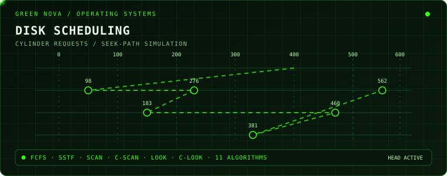

 

<strong>COMPUTER SCIENCE & ENGINEERING · LOVELY PROFESSIONAL UNIVERSITY</strong>

AI/ML · CYBERSECURITY · SOFTWARE ENGINEERING

<em>Build small. Think in systems. Keep learning.</em>

## <code>▰ 01 / ABOUT ME</code>

I'm **Priya Ranjan**, a Computer Science & Engineering student at **Lovely Professional University (LPU), India**. I build and explore practical software across **AI/ML, cybersecurity, backend systems, and web development**.

I like understanding how systems work under the hood—from algorithms and APIs to data pipelines and security signals—and turning that understanding into projects people can explore and use. My current priority is to strengthen core engineering fundamentals while building a credible, project-led portfolio.

## <code>▰ 02 / SELECTED PROJECTS</code>

<table>
<tr>
<td width="50%" valign="top">

### [VIREONIQ ↗](https://github.com/Priya-Ranjan-0201/VIREONIQ)

**Developer career roadmap and code-analysis engine.** Combines Python AST-based static complexity analysis with vector-search and career trajectory concepts.

**Stack:** Python · React · FastAPI · Qdrant

</td>
<td width="50%" valign="top">

### [TrustShield-X ↗](https://github.com/Priya-Ranjan-0201/TrustShield-X)

**Network and header security engine.** Focuses on asynchronous network inspection, signed logs, defensive analysis, and STIX 2.1 threat modeling.

**Stack:** Python 3.13 · AsyncIO · Networking · STIX 2.1

</td>
</tr>
<tr>
<td width="50%" valign="top">

### [Tech On Tour / TravelSathi ↗](https://github.com/Priya-Ranjan-0201/TECH-ON-TOUR)

**Smart tourism platform concept for the SIH finale.** Explores a multilingual travel twin, tourism discovery, and ways to support more informed, responsible travel.

**Stack:** Python · Web APIs · Smart Tourism · Multilingual UX

</td>
<td width="50%" valign="top">

### [Priocardix-AI ↗](https://github.com/Priya-Ranjan-0201/Priocardix-AI)

**Preventive cardiology platform.** Explores multi-parameter risk scoring and TreeSHAP explainability through a data-informed health-risk workflow.

**Stack:** JavaScript · AI/ML · Risk Scoring · Explainability

</td>
</tr>
<tr>
<td width="50%" valign="top">

### [BrainCheck ↗](https://github.com/Priya-Ranjan-0201/BrainCheck)

**Containerized cognitive assessment and quiz platform.** Organized around modular Flask Blueprints, PostgreSQL schemas, and Docker Compose.

**Stack:** Python · Flask · PostgreSQL · Docker

</td>
<td width="50%" valign="top">

### [Disk Scheduling Visualizer ↗](https://github.com/Priya-Ranjan-0201/Disk_Scheduling_Algorithm)

**Operating-systems storage and disk-kinematics simulator.** An HTML5 Canvas visualizer benchmarking 11 disk-scheduling algorithms with animated head movement.

**Stack:** JavaScript · HTML5 Canvas · Operating Systems · Algorithms

</td>
</tr>
</table>

<a href="https://github.com/Priya-Ranjan-0201/HRCV-"><b>HRCV- — AI career intelligence and ATS compatibility ↗</b></a>

## <code>▰ 03 / TECHNOLOGY STACK</code>

**Languages:** Python · JavaScript · Java · C/C++ · HTML · CSS · TypeScript

**Frontend:** React · TypeScript · Tailwind CSS

**Backend and data:** FastAPI · Flask · Django · REST APIs · PostgreSQL · MySQL · SQL

**AI/ML:** Machine learning · NLP · RAG concepts · data analysis · explainability

**Security and tooling:** Cybersecurity fundamentals · networking · Linux · Git · GitHub · Docker · testing

*These are technologies I've used, studied, or explored across coursework and projects; they are not a claim of equal proficiency in every tool.*

## <code>▰ 04 / GITHUB ACTIVITY</code>

  

**FEATURED REPOSITORY STARS**

  

  

  

**CONTRIBUTION GRID // GREEN NOVA**

These badges query GitHub/Shields dynamically. Language proportions and contribution history are best checked on each repository's Languages panel and the native GitHub profile. I have intentionally avoided hard-coded statistics and invented language percentages.

## <code>▰ 05 / CURRENTLY EXPLORING</code>

<table>
<tr>
<td width="33%" valign="top">

**AI / ML**

Building practical applications around machine learning, natural-language processing, retrieval, and explainable results.

</td>
<td width="33%" valign="top">

**Cybersecurity**

Strengthening networking and defensive engineering foundations through security-focused projects such as TrustShield-X.

</td>
<td width="33%" valign="top">

**Software Engineering**

Improving API design, modular architecture, testing, version control, containers, and maintainable full-stack development.

</td>
</tr>
</table>

**PrepPilot — interview-assistant project in development:** exploring interview knowledge bases, hybrid retrieval, resume/GitHub context, and question classification. No public repository link is included here because a public repository URL has not been verified.

## <code>▰ 06 / HOW I BUILD</code>

| UNDERSTAND | BUILD | VALIDATE | ITERATE |
|:---:|:---:|:---:|:---:|
| Define the problem | Make a working version | Test assumptions | Improve from evidence |

I value clear explanations, practical implementation, readable code, and honest reporting of what a project does. I prefer measurable functionality over decorative claims.

## <code>▰ 07 / CONNECT</code>

I'm interested in **internships and collaborative opportunities** related to AI/ML, cybersecurity, and software engineering.

  

<code>IDEAS → SYSTEMS → CODE → IMPACT</code>

GREEN NOVA · DESIGNED WITH CURIOSITY · BUILT ONE ITERATION AT A TIME

