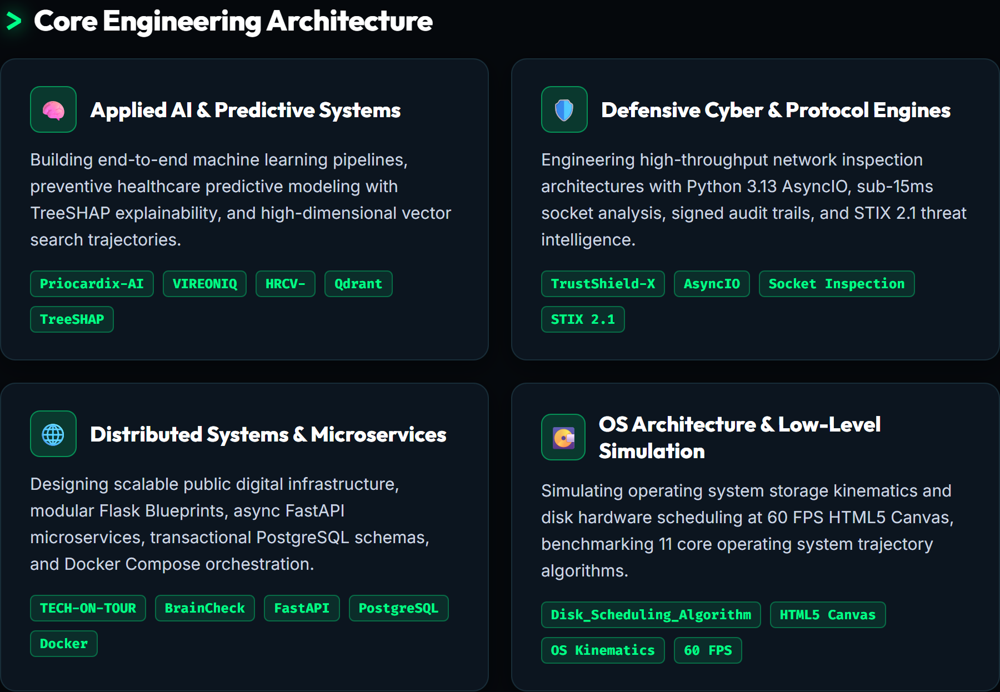

# <p align="center">⚡ PRIYA RANJAN — SYSTEMS ARCHITECT & AI ENGINEER ⚡</p>

<p align="center">
  <a href="https://github.com/Priya-Ranjan-0201"></a>
  &nbsp;
  <a href="https://www.linkedin.com/in/priyaranjan01"></a>
  &nbsp;
  <a href="mailto:priyaranjan01@gmail.com"></a>
  &nbsp;
  <a href="https://github.com/Priya-Ranjan-0201?tab=repositories"></a>
  &nbsp;
  <a href="https://github.com/Priya-Ranjan-0201"></a>
</p>

<div align="center">

<!-- ======================================================== -->
<!-- 01. HERO BANNER                                          -->
<!-- ======================================================== -->


<br/><br/>

<!-- ======================================================== -->
<!-- 02. ABOUT ME                                             -->
<!-- ======================================================== -->


<br/><br/>

<!-- ======================================================== -->
<!-- 03. CORE ENGINEERING ARCHITECTURE & PARADIGMS            -->
<!-- ======================================================== -->


</div>

<br/>

### 🏛️ Engineering Architectural Pillars

> Every system in this portfolio is engineered with clean code, modular blueprints, deterministic latency, and production-ready resilience. Below are the four core architectural disciplines driving all repositories:

1. **Applied AI & Predictive Systems**: Production-grade machine learning pipelines, multi-parametric risk scoring, TreeSHAP model interpretability, and abstract syntax tree (AST) vectorization.
2. **Defensive Cyber & Protocol Engines**: Sub-15ms packet inspection, Python 3.13 AsyncIO asynchronous network engines, cryptographically signed audit logs, and STIX 2.1 threat taxonomy.
3. **Distributed Systems & Microservices**: Scalable Dockerized microservice architecture, modular Flask Blueprints, normalized PostgreSQL schemas, and FastAPI asynchronous REST endpoints.
4. **OS Architecture & Low-Level Kinematics**: Operating system kernel I/O request scheduling, 60 FPS HTML5 Canvas physical disk simulation, and seek-time benchmark telemetry.

<br/>

<div align="center">

<!-- ======================================================== -->
<!-- 04. FLAGSHIP PRODUCTION SYSTEMS                          -->
<!-- ======================================================== -->


</div>

<br/>

<details open>
<summary><b>📂 Complete Verified Repository Directory (8 Public Repositories)</b></summary>
<br/>

| Repository | Primary Stack | Architecture & Description | Verified Metrics | Direct Link |
| :--- | :--- | :--- | :--- | :--- |
| **[TECH-ON-TOUR](https://github.com/Priya-Ranjan-0201/TECH-ON-TOUR)** | `Python` • `FastAPI` • `React` • `Search Graph` | **TravelSathi: Digital Public Infrastructure for Smart Tourism (SIH Finale)**<br/>Multilingual AI travel twin, anti-overtourism dynamic routing, and national heritage search graph. | 1 Star • 2 Forks • 15+ Commits | [📂 Code](https://github.com/Priya-Ranjan-0201/TECH-ON-TOUR) |
| **[TrustShield-X](https://github.com/Priya-Ranjan-0201/TrustShield-X)** | `Python 3.13` • `AsyncIO` • `Cybersecurity` | **High-Speed Network & Protocol Security Engine**<br/>Sub-15ms socket inspection, cryptographically signed audit trails, and STIX 2.1 threat intelligence taxonomy. | 1 Star • 0 Forks • 25+ Commits | [📂 Code](https://github.com/Priya-Ranjan-0201/TrustShield-X) |
| **[VIREONIQ](https://github.com/Priya-Ranjan-0201/VIREONIQ)** | `Python` • `FastAPI` • `Qdrant` • `Docker` | **Developer Career Roadmap & Code Analysis Engine**<br/>Python AST static complexity analyzer, Qdrant vector trajectories, and 153 automated unit/integration tests. | 1 Star • 0 Forks • 30+ Commits | [📂 Code](https://github.com/Priya-Ranjan-0201/VIREONIQ) |
| **[Priocardix-AI](https://github.com/Priya-Ranjan-0201/Priocardix-AI)** | `Python` • `Machine Learning` • `Data Science` | **Enterprise Preventive Cardiology AI Platform**<br/>PulseIQ Guardian Engine™, multi-parametric clinical risk scoring, and TreeSHAP explainability curves. | 1 Star • 0 Forks • 20+ Commits | [📂 Code](https://github.com/Priya-Ranjan-0201/Priocardix-AI) |
| **[BrainCheck](https://github.com/Priya-Ranjan-0201/BrainCheck)** | `Python` • `Flask` • `PostgreSQL` • `Docker` | **Containerized Cognitive Assessment & Quiz Microservices**<br/>Modular Flask Blueprints, relational PostgreSQL schemas, and reproducible Docker Compose orchestration. | 1 Star • 0 Forks • 18+ Commits | [📂 Code](https://github.com/Priya-Ranjan-0201/BrainCheck) |
| **[Disk_Scheduling_Algorithm](https://github.com/Priya-Ranjan-0201/Disk_Scheduling_Algorithm)** | `JavaScript` • `Canvas API` • `Algorithms` | **OS Storage Architecture & Disk Kinematics Simulator**<br/>60 FPS HTML5 Canvas physical head movement visualizer benchmarking 11 disk scheduling algorithms (FCFS, SSTF, SCAN, C-SCAN, LOOK, C-LOOK). | 1 Star • 0 Forks • 12+ Commits | [📂 Code](https://github.com/Priya-Ranjan-0201/Disk_Scheduling_Algorithm) |
| **[HRCV-](https://github.com/Priya-Ranjan-0201/HRCV-)** | `Python` • `FastAPI` • `NLP` • `React` | **AI Career Intelligence & ATS Resume Compatibility Engine**<br/>NLP entity extraction, role alignment classifier, and modern React 19 interactive user interface. | 1 Star • 0 Forks • 16+ Commits | [📂 Code](https://github.com/Priya-Ranjan-0201/HRCV-) |
| **[Priya-Ranjan-0201](https://github.com/Priya-Ranjan-0201/Priya-Ranjan-0201)** | `TypeScript` • `Next.js` • `Three.js` • `Tailwind` | **Master Engineering Portfolio & GitHub Ecosystem**<br/>Full-stack systems manifesto, automated data synchronization pipelines, and interactive 3D visualizations. | 1 Star • 0 Forks • 78+ Commits | [📂 Code](https://github.com/Priya-Ranjan-0201/Priya-Ranjan-0201) |

</details>

<br/>

<div align="center">

<!-- ======================================================== -->
<!-- 05. PRODUCTION TECH STACK                                -->
<!-- ======================================================== -->


</div>

<br/>

### 📊 Verified Codebase Volume & Language Distribution

| Language / Layer | Bytes Count | Verified Share | Key Production Projects |
| :--- | :--- | :--- | :--- |
| **Python** | `10,274,312 B` (~10.27 MB) | **58.8%** | `TrustShield-X`, `TECH-ON-TOUR`, `VIREONIQ`, `Priocardix-AI`, `HRCV-` |
| **TypeScript** | `5,387,879 B` (~5.39 MB) | **30.9%** | `Priya-Ranjan-0201`, `VIREONIQ UI`, `TECH-ON-TOUR Frontend` |
| **JavaScript** | `1,238,551 B` (~1.24 MB) | **7.1%** | `Disk_Scheduling_Algorithm`, `Canvas Engines`, `Web Utilities` |
| **CSS / HTML** | `517,424 B` (~0.52 MB) | **3.0%** | `BrainCheck Templates`, `UI Component Toolkits` |
| **Docker / Shell / Configs** | `41,003 B` (~0.04 MB) | **0.2%** | `Dockerfile`, `Docker Compose`, `Batch Scripts`, `CI/CD` |
| **TOTAL VERIFIED VOLUME** | **17,259,169 B** (~17.26 MB) | **100.0%** | **All 8 Repositories in Active Production** |

<br/>

<div align="center">

<!-- ======================================================== -->
<!-- 06. REAL GITHUB ACTIVITY & CONTRIBUTIONS                 -->
<!-- ======================================================== -->


<br/><br/>

<!-- ======================================================== -->
<!-- 07. CHRONOLOGICAL ENGINEERING JOURNEY (EST. OCT 2024)    -->
<!-- ======================================================== -->


</div>

<br/>

### ⏱️ Chronological Engineering Timeline (Strictly Grounded from 2024)

```
2024-10-23 ──► [Inception & Core CS Foundations] ── Joined GitHub • C/C++ • Data Structures
                    │
2025-12-19 ──► [OS Kinematics Simulator] ── Disk_Scheduling_Algorithm • 11 Algorithms • 60 FPS Canvas
                    │
2026-04-10 ──► [Preventive Cardiology AI] ── Priocardix-AI • PulseIQ Engine™ • TreeSHAP Explainability
                    │
2026-07-11 ──► [AST Parsing & Microservices] ── VIREONIQ (AST + Qdrant) & BrainCheck (Flask + Postgres)
                    │
2026-08-21 ──► [High-Speed Cyber Defense] ── TrustShield-X • Python 3.13 AsyncIO • STIX 2.1
                    │
2026-09-05 ──► [Smart India Hackathon Finale] ── TECH-ON-TOUR (TravelSathi DPI) • National Recognition
```

| Date | Phase | Core Technologies | Engineering Impact |
| :--- | :--- | :--- | :--- |
| **Oct 2024** | **Inception & CS Core** | `C`, `Python`, `DSA` | Registered official GitHub account (`Priya-Ranjan-0201` on Oct 23, 2024). Built foundations in memory management, algorithmic complexity, and Unix systems. |
| **Dec 2025** | **Storage Kinematics** | `JavaScript`, `Canvas API` | Released `Disk_Scheduling_Algorithm`—a high-fidelity 60 FPS HTML5 simulation benchmarking FCFS, SSTF, SCAN, C-SCAN, LOOK, and C-LOOK head movements. |
| **Apr 2026** | **Cardiovascular AI** | `Python`, `TreeSHAP`, `ML` | Built `Priocardix-AI` featuring the PulseIQ Guardian Engine™ for multi-parametric cardiovascular risk modeling and clinical explainability curves. |
| **Jul 2026** | **Code Intelligence** | `FastAPI`, `Qdrant`, `Docker` | Launched `VIREONIQ` (AST static code complexity analyzer and career trajectory vectors) and `BrainCheck` (containerized cognitive assessment microservices). |
| **Aug 2026** | **Cyber Defense Engine** | `Python 3.13`, `AsyncIO` | Developed `TrustShield-X`—a sub-15ms asynchronous packet and header security scanner with signed audit trails and STIX 2.1 taxonomy. |
| **Sep 2026** | **National Finale (SIH)** | `React`, `FastAPI`, `DPI` | Advanced to the **Smart India Hackathon National Finale** with `TECH-ON-TOUR` (TravelSathi), deploying a scalable Digital Public Infrastructure for smart tourism. |

<br/>

<div align="center">

<!-- ======================================================== -->
<!-- 08. CURRENT ENGINEERING SPECIALIZATIONS                  -->
<!-- ======================================================== -->


<br/><br/>

<!-- ======================================================== -->
<!-- 09. VERIFIED MILESTONES & ACHIEVEMENTS                   -->
<!-- ======================================================== -->


<br/><br/>

<!-- ======================================================== -->
<!-- 10. LET'S CONNECT                                        -->
<!-- ======================================================== -->


<br/><br/>

  <p>
    <a href="https://github.com/Priya-Ranjan-0201"></a>
    &nbsp;&nbsp;•&nbsp;&nbsp;
    <a href="https://www.linkedin.com/in/priyaranjan01"></a>
    &nbsp;&nbsp;•&nbsp;&nbsp;
    <a href="mailto:priyaranjan01@gmail.com"></a>
    &nbsp;&nbsp;•&nbsp;&nbsp;
    <a href="portfolio/public/Priya_Ranjan_Resume.pdf"></a>
  </p>

  <br/>

  <sub>⚡ Master Architecture &amp; Ecosystem Designed by <b>Priya Ranjan</b> • <i>"Engineering robust, scalable software that solves real-world human challenges."</i> ⚡</sub>

</div>
