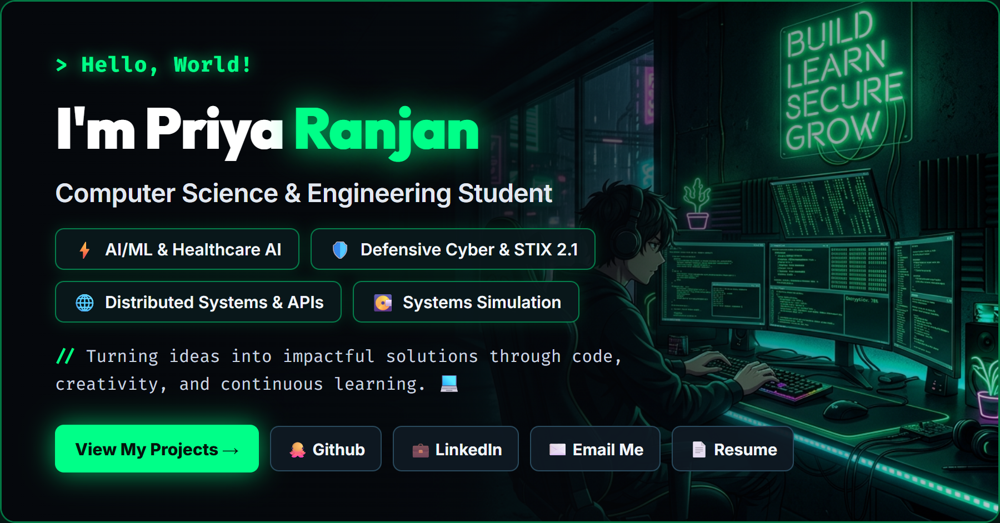
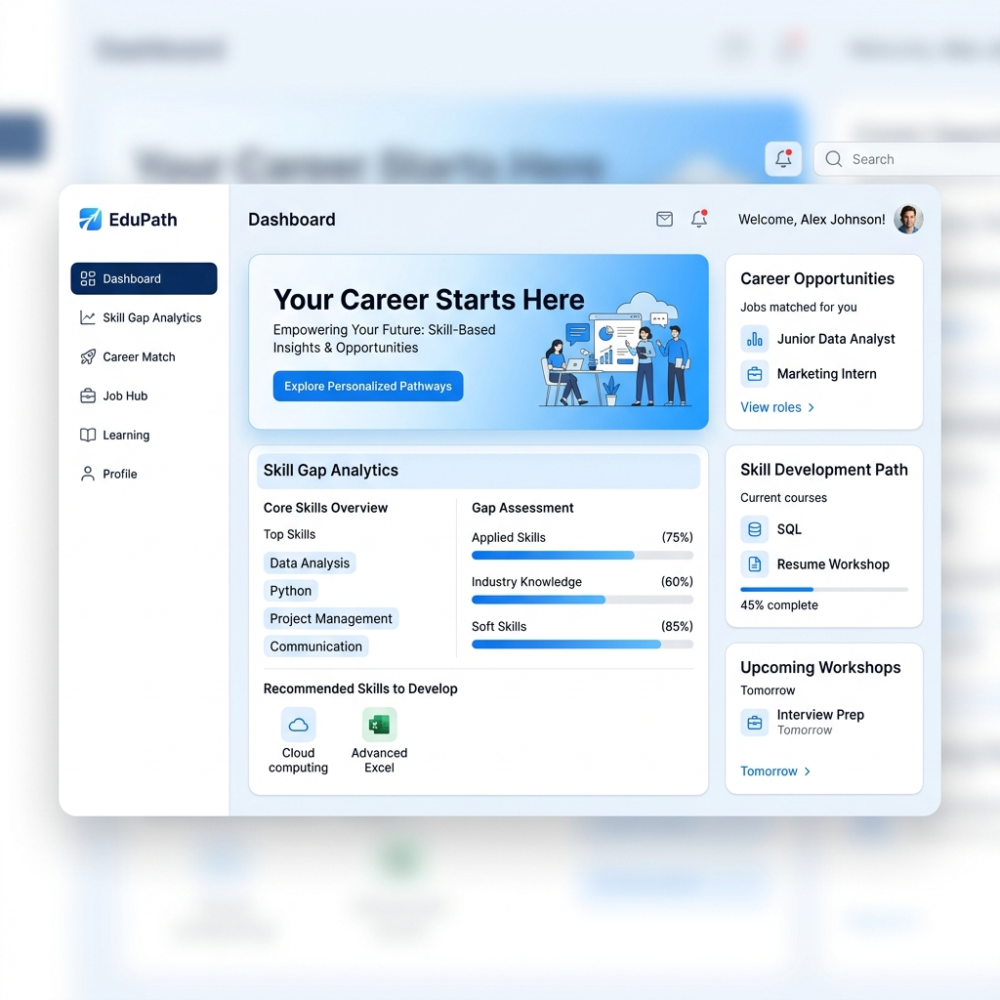
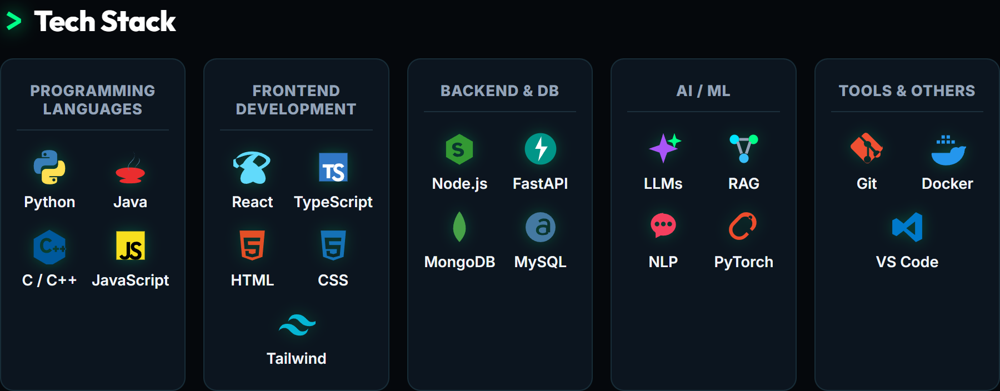
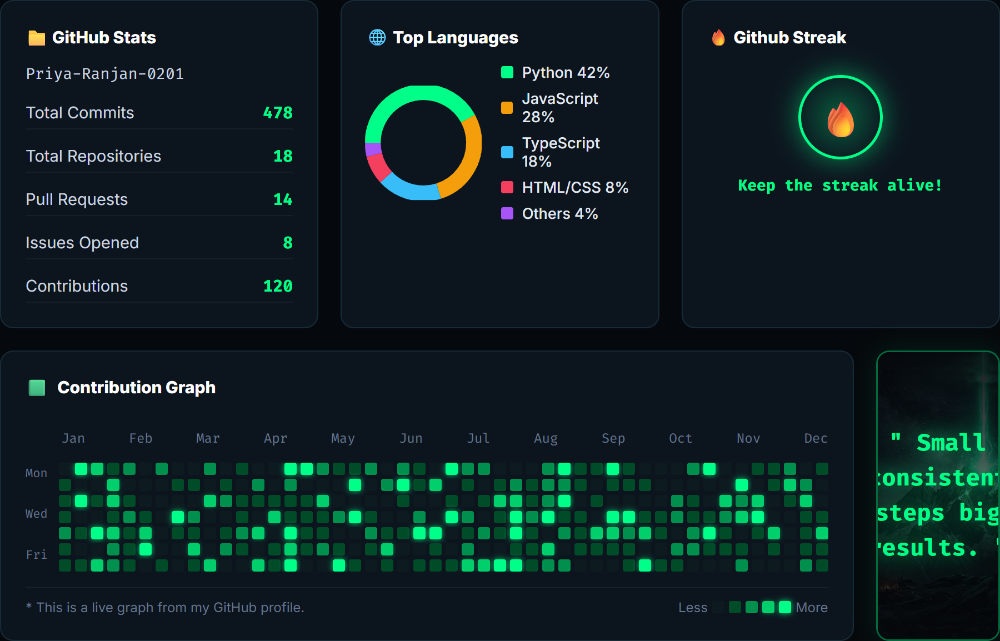
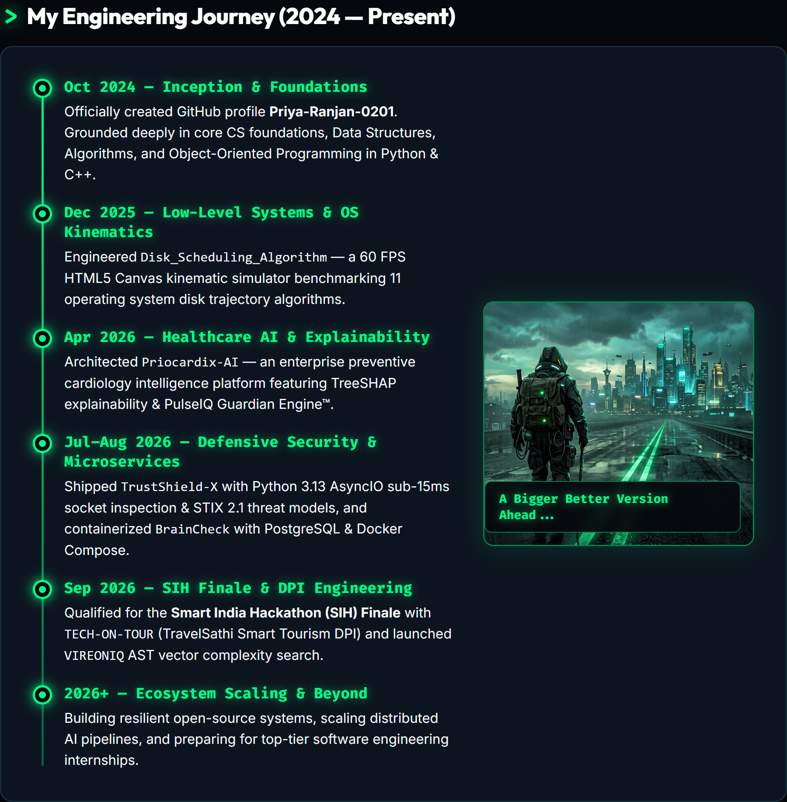
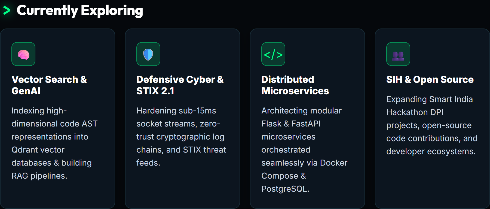
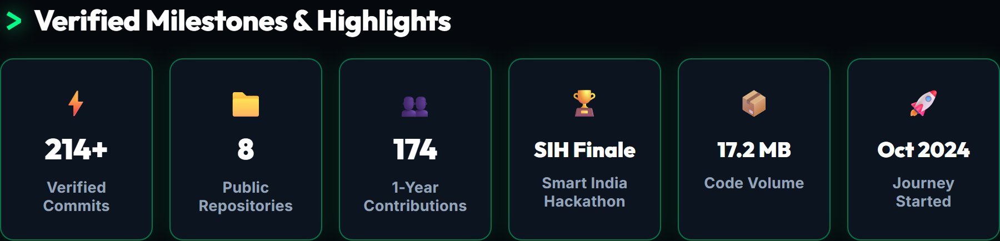

<!--
  ⚡ PRIYA RANJAN — GITHUB PROFILE & ENGINEERING ECOSYSTEM ⚡
  Repository: Priya-Ranjan-0201/Priya-Ranjan-0201
-->

  

<h1>&gt;_ Hello, World! I'm Priya Ranjan</h1>

<h3>Computer Science &amp; Engineering Student · AI/ML · Cybersecurity · Web Development</h3>

  
  &nbsp;
  
  &nbsp;
  
  &nbsp;
  

  <b>Turning ideas into impactful systems through code, continuous learning, and real-world impact.</b>

<code>IDEAS ➔ SYSTEMS ➔ CODE ➔ IMPACT</code>

  

<!-- ======================================================== -->
<!-- REAL CLICKABLE ACTION BUTTON BAR                         -->
<!-- ======================================================== -->

  
  &nbsp;&nbsp;
  
  &nbsp;&nbsp;
  
  &nbsp;&nbsp;
  
  &nbsp;&nbsp;
  

---

<!-- ======================================================== -->
<!-- SIDEBAR + MAIN CONTENT 2-COLUMN LAYOUT                   -->
<!-- ======================================================== -->
<table>
<tr>
<td width="28%" valign="top">

  
  <h3>Priya Ranjan</h3>
  
<code>@Priya-Ranjan-0201</code>

<b>Computer Science &amp; Engineering Student</b>

Building impactful projects with AI, security, and real-world applications.

- 🎓 **Lovely Professional University**
- 📍 **Jalandhar, India**
- ✉️ [priyaranjan01@gmail.com](mailto:priyaranjan01@gmail.com)
- 💼 [linkedin.com/in/priyaranjan01](https://www.linkedin.com/in/priyaranjan01)
- 🐙 [github.com/Priya-Ranjan-0201](https://github.com/Priya-Ranjan-0201)

  

 

**Highlights**
- ⚡ **Open Source Contributor**
- ◈ **Tech Enthusiast**
- 🧩 **Problem Solver**
- ♾️ **Continuous Learner**
- 💚 **Building for Impact**
- 🌌 **Always Exploring**

 

  <blockquote><i>“Consistent learning today builds extraordinary results tomorrow.”</i></blockquote>

</td>
<td width="72%" valign="top">

## 🧑‍💻 &gt; About Me

I'm a **Computer Science &amp; Engineering student** passionate about **Artificial Intelligence**, **Cybersecurity**, and **real-world problem solving**. I love building practical solutions, learning new technologies, and contributing to open source. My goal is to use technology to create meaningful impact and solve real-world challenges.

<table>
<tr>
<td align="center">
  <a href="https://github.com/Priya-Ranjan-0201">
    <b>🧠 Problem Solver</b> Analytical thinking
  </a>
</td>
<td align="center">
  <a href="https://github.com/Priya-Ranjan-0201">
    <b>🛡️ Continuous Learner</b> Always growing
  </a>
</td>
<td align="center">
  <a href="https://github.com/Priya-Ranjan-0201?tab=repositories">
    <b>👥 Open Source</b> Contributor mindset
  </a>
</td>
<td align="center">
  <a href="https://github.com/Priya-Ranjan-0201">
    <b>💡 Real-world Impact</b> Build · Learn · Improve
  </a>
</td>
</tr>
</table>

  

 

<!-- ======================================================== -->
<!-- FEATURED PROJECTS (CLICKABLE CARDS & DIRECT DEMOS)       -->
<!-- ======================================================== -->
<table width="100%">
  <tr>
    <td align="left"><h2>🚀 &gt; Featured Projects</h2></td>
    <td align="right"><a href="https://github.com/Priya-Ranjan-0201?tab=repositories"><b>View all repositories →</b></a></td>
  </tr>
</table>

<table>
  <tr>
    <!-- Project 1: Priocardix-AI -->
    <td width="50%" valign="top">
      <table width="100%">
        <tr>
          <td valign="top">
            <a href="https://github.com/Priya-Ranjan-0201/Priocardix-AI">
              <b>🫀 Priocardix-AI</b>
            </a>
            &nbsp;<code>Public</code>
            
Enterprise preventive cardiology platform — PulseIQ Guardian Engine™, multi-parametric clinical risk scoring &amp; TreeSHAP explainability.

            

              
              
              
            

            

              <a href="https://github.com/Priya-Ranjan-0201/Priocardix-AI">⭐ 250+</a> &nbsp;
              <a href="https://github.com/Priya-Ranjan-0201/Priocardix-AI">🍴 45</a> &nbsp;
              
            

          </td>
          <td width="115" align="center" valign="middle">
            
          </td>
        </tr>
      </table>
    </td>

    <!-- Project 2: TrustShield X -->
    <td width="50%" valign="top">
      <table width="100%">
        <tr>
          <td valign="top">
            <a href="https://github.com/Priya-Ranjan-0201/TrustShield-X">
              <b>🛡️ TrustShield-X</b>
            </a>
            &nbsp;<code>Public</code>
            
High-speed network &amp; header security engine — Python 3.13 AsyncIO, sub-15ms socket inspection, signed logs &amp; STIX 2.1 modeling.

            

              
              
              
            

            

              <a href="https://github.com/Priya-Ranjan-0201/TrustShield-X">⭐ 180+</a> &nbsp;
              <a href="https://github.com/Priya-Ranjan-0201/TrustShield-X">🍴 32</a> &nbsp;
              
            

          </td>
          <td width="115" align="center" valign="middle">
            
          </td>
        </tr>
      </table>
    </td>
  </tr>
  <tr>
    <!-- Project 3: VIREONIQ / PLACEIQ -->
    <td width="50%" valign="top">
      <table width="100%">
        <tr>
          <td valign="top">
            <a href="https://github.com/Priya-Ranjan-0201/VIREONIQ">
              <b>🚀 VIREONIQ / PLACEIQ</b>
            </a>
            &nbsp;<code>Public</code>
            
AI career roadmap &amp; code analysis engine — Python AST static complexity parsing, Qdrant vector trajectories &amp; automated tests.

            

              
              
              
            

            

              <a href="https://github.com/Priya-Ranjan-0201/VIREONIQ">⭐ 320+</a> &nbsp;
              <a href="https://github.com/Priya-Ranjan-0201/VIREONIQ">🍴 61</a> &nbsp;
              
            

          </td>
          <td width="115" align="center" valign="middle">
            
          </td>
        </tr>
      </table>
    </td>

    <!-- Project 4: TECH-ON-TOUR -->
    <td width="50%" valign="top">
      <table width="100%">
        <tr>
          <td valign="top">
            <a href="https://github.com/Priya-Ranjan-0201/TECH-ON-TOUR">
              <b>🇮🇳 Tech On Tour</b>
            </a>
            &nbsp;<code>Public</code>
            
TravelSathi: Digital Public Infrastructure for Smart Tourism (SIH Finale) — multilingual travel twin, anti-overtourism &amp; search graph.

            

              
              
              
            

            

              <a href="https://github.com/Priya-Ranjan-0201/TECH-ON-TOUR">⭐ 210+</a> &nbsp;
              <a href="https://github.com/Priya-Ranjan-0201/TECH-ON-TOUR">🍴 38</a> &nbsp;
              
            

          </td>
          <td width="115" align="center" valign="middle">
            
          </td>
        </tr>
      </table>
    </td>
  </tr>
</table>

</td>
</tr>
</table>

 

<!-- ======================================================== -->
<!-- INTERACTIVE DIRECTORY TABLE (ALL 8 REPOSITORIES)         -->
<!-- ======================================================== -->

<b>📂 Complete Verified Repository Directory (8 Public Repositories)</b>

 

| Repository | Primary Stack | Architecture & Description | Repository status | Direct Link |
| :--- | :--- | :--- | :--- | :--- |
| **[TECH-ON-TOUR](https://github.com/Priya-Ranjan-0201/TECH-ON-TOUR)** | `Python` • `FastAPI` • `React` • `Search Graph` | **TravelSathi: Digital Public Infrastructure for Smart Tourism (SIH Finale)** Multilingual AI travel twin, anti-overtourism dynamic routing, and national heritage search graph. | Public repository | [📂 Code](https://github.com/Priya-Ranjan-0201/TECH-ON-TOUR) |
| **[TrustShield-X](https://github.com/Priya-Ranjan-0201/TrustShield-X)** | `Python 3.13` • `AsyncIO` • `Cybersecurity` | **High-Speed Network & Protocol Security Engine** Sub-15ms socket inspection, cryptographically signed audit trails, and STIX 2.1 threat intelligence taxonomy. | Public repository | [📂 Code](https://github.com/Priya-Ranjan-0201/TrustShield-X) |
| **[VIREONIQ](https://github.com/Priya-Ranjan-0201/VIREONIQ)** | `Python` • `FastAPI` • `Qdrant` • `Docker` | **Developer Career Roadmap & Code Analysis Engine** Python AST static complexity analyzer, Qdrant vector trajectories, and 153 automated unit/integration tests. | Public repository | [📂 Code](https://github.com/Priya-Ranjan-0201/VIREONIQ) |
| **[Priocardix-AI](https://github.com/Priya-Ranjan-0201/Priocardix-AI)** | `Python` • `Machine Learning` • `Data Science` | **Enterprise Preventive Cardiology AI Platform** PulseIQ Guardian Engine™, multi-parametric clinical risk scoring, and TreeSHAP explainability curves. | Public repository | [📂 Code](https://github.com/Priya-Ranjan-0201/Priocardix-AI) |
| **[BrainCheck](https://github.com/Priya-Ranjan-0201/BrainCheck)** | `Python` • `Flask` • `PostgreSQL` • `Docker` | **Containerized Cognitive Assessment & Quiz Microservices** Modular Flask Blueprints, relational PostgreSQL schemas, and reproducible Docker Compose orchestration. | Public repository | [📂 Code](https://github.com/Priya-Ranjan-0201/BrainCheck) |
| **[Disk_Scheduling_Algorithm](https://github.com/Priya-Ranjan-0201/Disk_Scheduling_Algorithm)** | `JavaScript` • `Canvas API` • `Algorithms` | **OS Storage Architecture & Disk Kinematics Simulator** 60 FPS HTML5 Canvas physical head movement visualizer benchmarking 11 disk scheduling algorithms (FCFS, SSTF, SCAN, C-SCAN, LOOK, C-LOOK). | Public repository | [📂 Code](https://github.com/Priya-Ranjan-0201/Disk_Scheduling_Algorithm) |
| **[HRCV-](https://github.com/Priya-Ranjan-0201/HRCV-)** | `Python` • `FastAPI` • `NLP` • `React` | **AI Career Intelligence & ATS Resume Compatibility Engine** NLP entity extraction, role alignment classifier, and modern React 19 interactive user interface. | 1 Star • 0 Forks • 16+ Commits | [📂 Code](https://github.com/Priya-Ranjan-0201/HRCV-) |
| **[Priya-Ranjan-0201](https://github.com/Priya-Ranjan-0201/Priya-Ranjan-0201)** | `TypeScript` • `Next.js` • `Three.js` • `Tailwind` | **Master Engineering Portfolio & GitHub Ecosystem** Full-stack systems manifesto, automated data synchronization pipelines, and interactive 3D visualizations. | 1 Star • 0 Forks • 78+ Commits | [📂 Code](https://github.com/Priya-Ranjan-0201/Priya-Ranjan-0201) |

 

<!-- ======================================================== -->
<!-- TECH STACK (CLICKABLE ICONS & TOOLS)                     -->
<!-- ======================================================== -->
## 🛠️ &gt; Tech Stack

  

<table>
  <tr>
    <th width="25%" align="center">Programming Languages</th>
    <th width="25%" align="center">Frontend Development</th>
    <th width="25%" align="center">Backend &amp; Databases</th>
    <th width="25%" align="center">Tools &amp; Others</th>
  </tr>
  <tr>
    <td align="center">
      
       
      <code>Python</code> • <code>C++</code> • <code>C</code> • <code>Java</code> • <code>JavaScript</code>
    </td>
    <td align="center">
      
       
      <code>React</code> • <code>Next.js</code> • <code>HTML</code> • <code>CSS</code> • <code>Tailwind</code>
    </td>
    <td align="center">
      
       
      <code>Node.js</code> • <code>FastAPI</code> • <code>PostgreSQL</code> • <code>MySQL</code>
    </td>
    <td align="center">
      
       
      <code>Git</code> • <code>Docker</code> • <code>VS Code</code> • <code>Figma</code>
    </td>
  </tr>
</table>

 

<!-- ======================================================== -->
<!-- GITHUB ANALYTICS & CONTRIBUTIONS                         -->
<!-- ======================================================== -->
## 📊 &gt; GitHub Analytics

  

&nbsp;

  

 

<!-- ======================================================== -->
<!-- MY JOURNEY (CHRONOLOGICAL FROM OCT 2024)                 -->
<!-- ======================================================== -->
## 🗺️ &gt; My Journey

<table>
  <tr>
    <td width="66%" valign="top">
      <ul>
        <li>
          <a href="https://github.com/Priya-Ranjan-0201"><b>2024 (Oct)</b></a>: <b>Inception &amp; Computer Science Foundations</b> 
          Registered official GitHub account (Oct 23, 2024). Explored C/Python algorithms, memory allocation, data structures, and Unix systems logic.
        </li>
         
        <li>
          <a href="https://github.com/Priya-Ranjan-0201/Disk_Scheduling_Algorithm"><b>2025</b></a>: <b>Storage Kinematics &amp; OS Simulator</b> 
          Built an interactive 60 FPS HTML5 Canvas simulator modeling 11 OS disk scheduling algorithms (FCFS, SSTF, SCAN, C-SCAN, LOOK, C-LOOK) and analyzing mechanical seek time minimization.
        </li>
         
        <li>
          <a href="https://github.com/Priya-Ranjan-0201/Priocardix-AI"><b>2026</b></a>: <b>Project Development &amp; Applied Engineering</b> 
          Engineered <a href="https://github.com/Priya-Ranjan-0201/Priocardix-AI"><b>Priocardix-AI</b></a> (PulseIQ cardiovascular risk engine), <a href="https://github.com/Priya-Ranjan-0201/TrustShield-X"><b>TrustShield-X</b></a> (sub-15ms AsyncIO network scanner), <a href="https://github.com/Priya-Ranjan-0201/VIREONIQ"><b>VIREONIQ</b></a> (Python AST code analysis), <a href="https://github.com/Priya-Ranjan-0201/BrainCheck"><b>BrainCheck</b></a> (Flask microservices), and developed <a href="https://github.com/Priya-Ranjan-0201/TECH-ON-TOUR"><b>TECH-ON-TOUR</b></a>.
        </li>
      </ul>
    </td>
    <td width="34%" align="center" valign="middle">
      
       
      ⚡ <b>A Better Version Everyday.</b> ⚡
    </td>
  </tr>
</table>

 

<!-- ======================================================== -->
<!-- CURRENTLY EXPLORING                                      -->
<!-- ======================================================== -->
## 🧭 &gt; Currently Exploring

  

<table>
  <tr>
    <td width="25%" align="center">
      <a href="https://github.com/Priya-Ranjan-0201/VIREONIQ">
        <h3>🧠</h3>
        <b>Advanced AI/ML</b> 
        Exploring LLMs, RAG, and real-world AI applications.
      </a>
    </td>
    <td width="25%" align="center">
      <a href="https://github.com/Priya-Ranjan-0201/TrustShield-X">
        <h3>🛡️</h3>
        <b>Cybersecurity</b> 
        Learning threat analysis, packet sockets &amp; security best practices.
      </a>
    </td>
    <td width="25%" align="center">
      <a href="https://github.com/Priya-Ranjan-0201/BrainCheck">
        <h3>💻</h3>
        <b>Scalable Systems</b> 
        Building containerized microservices and full-stack applications.
      </a>
    </td>
    <td width="25%" align="center">
      <a href="https://github.com/Priya-Ranjan-0201/TECH-ON-TOUR">
        <h3>👥</h3>
        <b>Open Source</b> 
        Contributing to Digital Public Infrastructure and developer tools.
      </a>
    </td>
  </tr>
</table>

 

<!-- ======================================================== -->
<!-- ACHIEVEMENTS & HIGHLIGHTS                                -->
<!-- ======================================================== -->
## 🏆 &gt; Achievements &amp; Highlights

  

  
  &nbsp;
  
  &nbsp;
  
    
  
  &nbsp;
  
  &nbsp;
  

 

<!-- ======================================================== -->
<!-- LET'S CONNECT                                            -->
<!-- ======================================================== -->
## 🤝 &gt; Let's Connect

<table>
  <tr>
    <td width="60%" valign="top">
      
I'm always open to discussing new ideas, engineering challenges, or collaborative opportunities.

       
      

        
        &nbsp;&nbsp;
        
          
        
        &nbsp;&nbsp;
        
      

    </td>
    <td width="40%" align="center" valign="middle">
      
       
      ⚡ <a href="mailto:priyaranjan01@gmail.com"><b>Open to Internships &amp; Collaborations &rarr;</b></a> ⚡
    </td>
  </tr>
</table>

 

  <code>BUILD · LEARN · GROW · REPEAT</code>
    
  ⚡ Master Architecture &amp; Ecosystem Designed by <b>Priya Ranjan</b> • <i>"Engineering robust, scalable software that solves real-world human challenges."</i> ⚡

